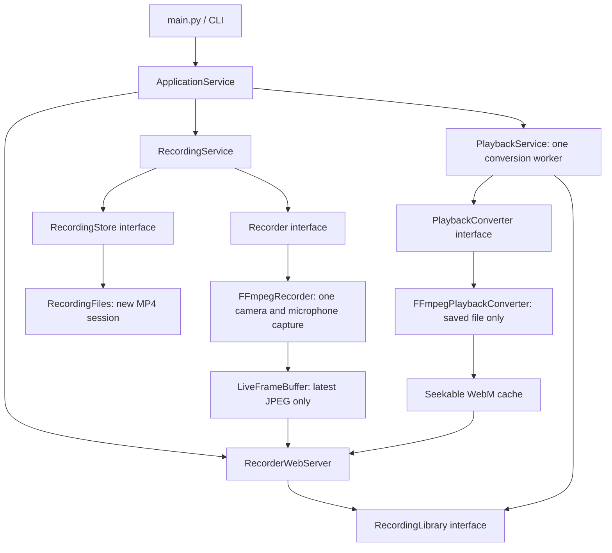

# Camera recorder

Run the app to start recording video and microphone audio immediately:

```sh
make run
```

Open **http://127.0.0.1:8080** for the live view, saved recordings, replay, and
original-file downloads. Press **Ctrl+C** to stop and finalize the recording.
Each session saves a new `.mp4` file in `recordings/` next to `main.py`.
Bare `make` and `python3 main.py` start the same app.

## Raspberry Pi hotspot

The [NixOS Pi 4 image](nixos/README.md) starts recording and opens a Wi-Fi
hotspot automatically at boot:

| Setting | Value |
| --- | --- |
| Wi-Fi name | `FPV-Recorder` |
| Wi-Fi password | `12345678` |
| Browser address | **http://192.168.4.1** |

Connect your phone or computer to that Wi-Fi, stay connected if it reports
**no internet**, and enter the browser address. No SSH, login, external router,
or internet connection is needed. The hotspot does not share internet access.
Its configuration is in `nixos/hosts/pi4/hotspot.nix`; the country is set to
Lithuania (`LT`). Set the country to where you operate the Pi.

To build a bootable SD image on a Linux PC with Docker, Python 3, and `zstd`, run:

```sh
make image
```

This sets up ARM64 emulation on x86_64 hosts, builds the image, and decompresses
it to `result-image/fpv-recorder-pi4.img`. The build checks that the firmware
partition contains FAT32 and that the partition geometry fits the image before
publishing it. Open that file in Raspberry Pi Imager to write your SD card.
Run `make image-check` to repeat the structural check without accessing a card.
See the deployment guide for details.

The app keeps recording without a browser connected. If the camera or
microphone is unavailable, it retries every two seconds while keeping the page
and existing recordings available. Recordings on the Pi are stored in
`/var/lib/fpv-recorder/recordings`.

To retrieve files directly from the SD card, shut down the Pi and mount the
card's ext4 root partition on Linux. Open `var/lib/fpv-recorder/recordings` on
that partition and copy the `.mp4` files (or older `.mkv` recordings). New images
allow other users to read recordings; see the deployment guide's storage section
for a permission fix on older cards.

Image build and structural validation are separate from verifying the written
card, physical Pi boot, Wi-Fi connectivity, and Pi performance. Those checks
still require the target hardware.

## Live view and replay

- **Live view** shows video from the same camera capture process used for
  recording. It has no live audio. Saved recordings include microphone audio.
- **Rotation** below the live view adjusts the preview from −180° to +180° in
  1° steps, with left/right 90° buttons and Reset. The whole rotated picture
  fits inside the viewer. Each browser remembers its angle; recording and replay
  keep the camera's original orientation.
- **Replay** prepares a browser-compatible WebM copy of a selected finished
  recording, then opens it with playback, sound, and seeking controls. Long
  recordings take longer to prepare. Further replays reuse the cached copy.
- **Download original** saves the recorded `.mp4`. New recordings use H.264
  video and AAC audio; replay copies use VP8 video and Opus audio. Older MJPEG
  MKV recordings remain available for replay and download.
- The current recording appears in the library after its session finishes.
  There is no remote stop button; recording continues while you browse.
- Preparation runs one file at a time with one video encoder thread and lower
  CPU priority. Slow viewers skip old live frames rather than blocking capture.
  Up to four live viewers can connect at once.

Playback copies use additional storage in `recordings/.playback-cache/`. They
are not deleted automatically. With the app stopped, you can remove that cache
directory to reclaim space; original recordings are outside it. Originals are
never rotated or deleted automatically. Partial recordings after a failure are
preserved and listed if nonempty, but may not be playable.

## Disk writes and power loss

Recording data is written directly to MP4 during capture. FFmpeg's
`hybrid_fragmented` mode writes recoverable fragments while recording, then
converts the file to a regular MP4 on clean shutdown. Finished files include
duration and exact sample-count metadata for editors. Interrupted files retain
completed fragments but may still need remuxing for particular editors.
See [FFmpeg's MP4 documentation](https://ffmpeg.org/ffmpeg-formats.html#Fragmentation).

The defaults close MP4 fragments after about one second of media,
request an H.264 keyframe about every second, and
flush FFmpeg's output buffers. A background worker calls `fsync` on the recording
and its directory entries every second. This reduces both application buffering
and Linux's dirty-file cache; it does not wait until recording stops to sync.

These defaults are in `recorder/config.py`:

| Setting | Default |
| --- | --- |
| `recording_fragment_duration_milliseconds` | `1000` |
| `recording_sync_interval_seconds` | `1.0` |
| `recording_sync_shutdown_timeout_seconds` | `2.0` |

The sync worker does not block capture on each flush. Sync failures fail the
recording instead of reporting success. Normal shutdown finalizes FFmpeg and
requests a final sync, with a separate two-second wait deadline. A blocked sync
worker prevents additional sync workers from accumulating across capture retries.

The one-second settings are **not a maximum footage-loss guarantee**. Encoder
buffers, slow storage, filesystem errors, and SD-card controller behavior can
still lose data. Shorter keyframe spacing may also increase file size. Use normal
shutdown, or hardware that supplies enough power for shutdown, when preservation
is essential. See [Linux fsync documentation](https://man7.org/linux/man-pages/man2/fsync.2.html)
for the distinction between syncing a file and its directory entry.

Tests verify periodic/final syncing, error reporting, bounded sync shutdown, and
decodable audio/video after abruptly killing Python and FFmpeg. Killing processes
leaves Linux's cache intact, so this does not validate a physical Pi power cut.
Install a rebuilt image to apply these changes to the Pi.

## Importing recordings into video enhancers and editors

New recordings are MP4 from the start. A clean stop produces a regular MP4 with
exact frame counts; no separate export is needed. Older MKV recordings interrupted
by power removal can contain playable media without duration/index metadata.
REAL Video Enhancer's OpenCV-based reader can report an invalid negative frame
count for those files and reject the input. A missing explicit frame-count field
alone does not establish that a recording is corrupt.

For an older H.264/AAC MKV or an interrupted MP4 rejected by an editor, use a
recent FFmpeg build to rebuild a regular MP4 without re-encoding:

```sh
ffmpeg -hide_banner -nostdin -n -i recordings/capture-example.mkv \
  -map 0:v:0 -map '0:a:0?' -c copy -avoid_negative_ts make_zero \
  -movflags +faststart recordings/capture-example-enhancer.mp4
```

Replace the example filenames with the actual recording. Open the MP4 in the
editor. This rebuilds container metadata, retains the encoded video and audio,
and preserves the original. For an interrupted MP4, use that as the input and
keep a different output filename. This cannot restore footage lost before it reached
storage. Older MJPEG recordings need separate compatibility checks; this command
is intended for the app's current H.264/AAC output. If an old FFmpeg build emits
timestamp warnings, use a newer build rather than assuming the export is correct.

Recording uses hybrid fragmented MP4 rather than relying on a regular MP4's
final index for all recoverability. Process-kill recovery is covered by tests;
physical power removal can still damage storage or the unfinished fragment.

## Capture settings

The defaults in `recorder/config.py` request `/dev/video0`, MJPEG video at
**640x480 and PAL's 25 fps**, and the system's default microphone. Saved video
is compressed to H.264 using `libx264`, the `veryfast` preset, and two encoder
threads. Audio uses AAC at 128 kbit/s. The live preview still copies the original
MJPEG frames from the same capture process. Close OBS or deactivate its camera
source before starting the recorder.

Recording compression settings are also in `recorder/config.py`:

| Setting | Default | Effect |
| --- | --- | --- |
| `recording_video_quality_crf` | `18` | Favors detail over small files. Lower values give higher quality and larger files; higher values reduce size. |
| `recording_video_max_bitrate_bits_per_second` | `6_000_000` | Limits video bitrate using a two-second buffer; complex scenes may lose detail to fit. |
| `recording_audio_bitrate_bits_per_second` | `128_000` | Microphone audio bitrate. |

At the video bitrate limit, allow roughly **2.8 GB per hour** including audio,
plus container overhead. Simpler scenes usually use less; this is an estimate,
not a fixed file-size guarantee. Compression is lossy and adds CPU work. Sustained
25 fps with live viewing and replay preparation still needs validation on the
Pi 4. These defaults replace the more aggressive CRF 23 / 1.5 Mbit/s settings.
They keep compression while giving moving, noisy scenes more bitrate. Existing
recordings are not recompressed or deleted. Rebuild the Pi image
with `make image` and install it to deploy these defaults.

640x480 is the highest resolution advertised by the connected ARKMICRO USB DVR.
Measured input frames arrived about 40 ms apart (approximately 25 fps). The
adapter may negotiate a different rate in its metadata. Requested settings do
not guarantee the negotiated mode or actual frame timing. Higher resolutions
require a capture device that supports them.

On Raspberry Pi OS, install the dependencies first:

```sh
sudo apt install python3 ffmpeg make
```

Use an FFmpeg build with MJPEG decoding, `libx264`/AAC encoding for recording, and `libvpx`/`libopus`
encoders for replay; the Nix package supplies these. Set `audio_device_name` to
the microphone's ALSA identifier if it is not the default. The Nix service uses
`plughw:CARD=LAV,DEV=0` directly without a desktop audio server. The service's udev rule
names the Ugreen adapter (C-Media USB ID `0d8c:0014`, identified in the Pi's logs)
`LAV`, regardless of its USB port or card number. The DVR's `CAMERA` audio input
is not the separate lav microphone. If the Ugreen adapter is absent, capture
retries rather than silently recording from another input.

The MP4 muxer must support `hybrid_fragmented`; the Nix image includes FFmpeg
8.1. Check with `ffmpeg -hide_banner -h muxer=mp4`. Distribution packages can be
older or omit encoder support; the apt command above alone does not establish
compatibility. The recorder reports an error rather than falling back to a
nonrecoverable regular MP4.

Connect the lav to the adapter's microphone/headset input. After installing the
updated image, record a short speech sample and listen to a downloaded MP4 or
browser replay; live preview has no sound. Check capture mute/gain and the
microphone's connector compatibility if the correctly selected input is still
silent. The input selection fix does not establish the microphone's signal level.

Check H.264 encoder availability with `ffmpeg -hide_banner -h encoder=libx264`.
Some distribution FFmpeg builds omit it; install a build that includes it before
running the app. There is no automatic fallback to large MJPEG recordings.

`Settings.from_environment()` supports deployment overrides for
`FPV_AUDIO_DEVICE_NAME`, `FPV_RECORDINGS_DIRECTORY_PATH`, `FPV_WEB_BIND_ADDRESS`,
and `FPV_WEB_PORT`. Local HTTP defaults to loopback port 8080; the Nix service
binds port 80 on all interfaces, with a firewall opening on `wlan0`. Camera
settings remain defined in the app only. Port 0 selects an ephemeral port for
automated tests. The page is intended for the private hotspot; anyone connected
to that network can view and download recordings.

## Development commands

| Command | Action |
| --- | --- |
| `make run` | Start recording and the browser page. |
| `make test` | Run component and generated-media integration tests. |
| `make check` | Check Python and image-builder shell syntax. |
| `make image` | Build and decompress the Pi 4 SD image using Docker. |
| `make image-check` | Validate the exported image layout without accessing devices. |
| `make nixos-check` | Evaluate the NixOS configuration. |
| `make nixos-image` | Build the Pi 4 SD image using an AArch64 builder. |
| `make clean` | Remove Python caches; preserve recordings and playback copies. |
| `make help` | Show commands. |

Use another interpreter with `make test PYTHON=.venv/bin/python`. Do not use
bare `make` for build verification: it starts capture. `make -n run` prints the
launch command without accessing devices. Package version metadata comes from
`pyproject.toml`.

## Architecture



- `main.py` launches the CLI; `recorder/cli.py` presents status and exit codes.
- `recorder/bootstrap.py` connects dependencies; `config.py` owns app defaults.
- `recorder/services/` coordinates recording, retry lifecycle, and replay jobs.
- `recorder/ports/` defines capture, storage, library, converter, and browser
  lifecycle contracts, including recording sync operations.
- `recorder/ffmpeg/` builds capture arguments, owns the capture child, and
  prepares saved-file playback copies in a separate adapter.
- `recorder/live/` parses captured multipart JPEG frames and keeps the newest.
- `recorder/storage/` creates recording paths, checks saves, and confines
  library access to finished regular files. `recording_file_syncer.py` owns
  periodic and final recording/directory syncing in a separate worker.
- `recorder/web/` serves HTTP routes and bundled HTML/CSS/JavaScript offline.
- `recorder/recording_state.py` shares recording status safely across threads.
- `recorder/signals.py` turns Ctrl+C/SIGTERM into a shared stop event;
  `recorder/errors/` contains application error types.

Only the capture process accesses devices; replay conversion reads saved media.
The live reader always drains FFmpeg output, independently of browser clients.
On shutdown, capture gets up to 15 seconds to finalize before it is killed and
reaped; conversion is cancelled and its partial cache file removed. Originals
and partial recordings are preserved. Existing recordings cannot be overwritten.
A successful save requires a successful capture result, successful final sync,
and a nonempty file;
this does not establish hardware signal quality or A/V synchronization.

Tests use generated media and mocks, never physical capture devices. They cover
capture and replay decoding, shared live frames, seeking, file access, retries,
conversion failures, shutdown, original-file protection, and disk write failures.
See [AGENTS.md](AGENTS.md) for implementation guidelines and
[the deployment guide](nixos/README.md) for installation.
