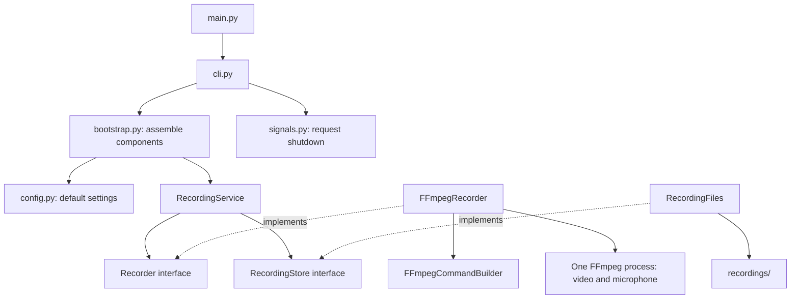

# Camera recorder

Run the app to start recording video and microphone audio immediately:

```sh
make run
```

Press **Ctrl+C** to stop. Each run saves a new `.mkv` file in `recordings/`
next to `main.py`.

Running `make` also starts recording. You can run `python3 main.py` directly.

The defaults use `/dev/video0`, MJPEG video at 640x480 and a requested 60 fps,
and the system's default microphone. Video is saved without re-encoding; audio
is saved as AAC. Close OBS or deactivate its camera source before starting the
recorder.

640x480 is the highest resolution advertised by the connected ARKMICRO USB
capture device. It advertises approximately 60 fps at that resolution. Capture
requests this mode directly; actual delivered frame rate and unique frames still
depend on the input signal and device. The app preserves the received video
without upscaling or frame duplication.

Hardware checks on the current input delivered frames about 40 ms apart
(approximately 25 fps), despite negotiating a 60 fps mode. Lower-resolution
checks also delivered approximately 25 fps. The requested 60 fps setting cannot
make this input deliver additional frames. True 60 fps capture requires a source
and capture device that actually deliver that rate; a 60 fps stream label alone
does not confirm it.

`video_size` and `video_fps` in `recorder/config.py` control the requested capture
mode. A higher resolution requires a capture device that supports it.

On Raspberry Pi OS, install Python and FFmpeg first:

```sh
sudo apt install python3 ffmpeg make
```

Run the app on the Pi with the capture device and microphone connected. If its
microphone is not the ALSA default, change `audio_device` in `recorder/config.py`
to its ALSA name, for example `plughw:CARD=CAMERA,DEV=0`.

## Development commands

| Command | Action |
| --- | --- |
| `make run` | Start recording with the default settings. |
| `make test` | Run all tests, including FFmpeg integration checks. |
| `make check` | Check Python syntax. |
| `make clean` | Remove generated Python caches; recordings are preserved. |
| `make help` | Show available commands. |

To use another interpreter: `make test PYTHON=.venv/bin/python`.

See [AGENTS.md](AGENTS.md) for architecture, coding, recording lifecycle, and
validation guidelines.

## Architecture

Each component has its own file, grouped by responsibility:

```text
main.py
recorder/
├── cli.py                         # Terminal entry point and exit status
├── bootstrap.py                   # Construct and connect the components
├── config.py                      # Immutable default settings
├── signals.py                     # Ctrl+C/SIGTERM to a stop request
├── services/
│   └── recording_service.py       # Coordinate the recording workflow
├── ports/
│   ├── recorder.py                # Capture interface
│   └── recording_store.py         # File storage interface
├── ffmpeg/
│   ├── command_builder.py         # Build the capture command
│   └── ffmpeg_recorder.py         # Own the process and finalize capture
├── storage/
│   └── recording_files.py         # Output paths and completed-file checks
└── errors/
    └── recording_error.py         # Recording failure type
```



The service depends on capture and storage interfaces. Concrete FFmpeg and file
storage implementations are connected in `bootstrap.py`. The CLI presents
results and handles recording errors; signal handling lives in `signals.py`.
The shared stop event lets the capture process respond to shutdown without
installing OS signal handlers itself.

The command builder handles capture settings and FFmpeg arguments. The recorder
owns the child process, forwards the stop request, and enforces the shutdown
deadline. Video and audio stay in one process for one capture and finalization
lifecycle.

Existing files cannot be overwritten. On a stop request, FFmpeg gets up to 15
seconds to finalize the file before its process is killed and reaped. Failed
capture never reports a successful save; partial files remain available for
recovery. Storage checks for a nonempty file; this does not prove that a hardware
signal is present or that audio is audible.

Tests are split into service, signal handling, FFmpeg process control, and
recording integration files. Generated media exercises actual capture output,
playback decoding, graceful shutdown, file protection, and write failures.
